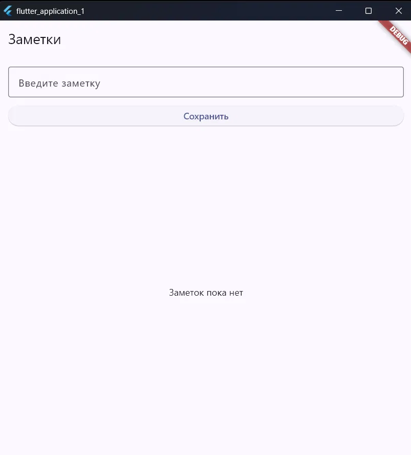
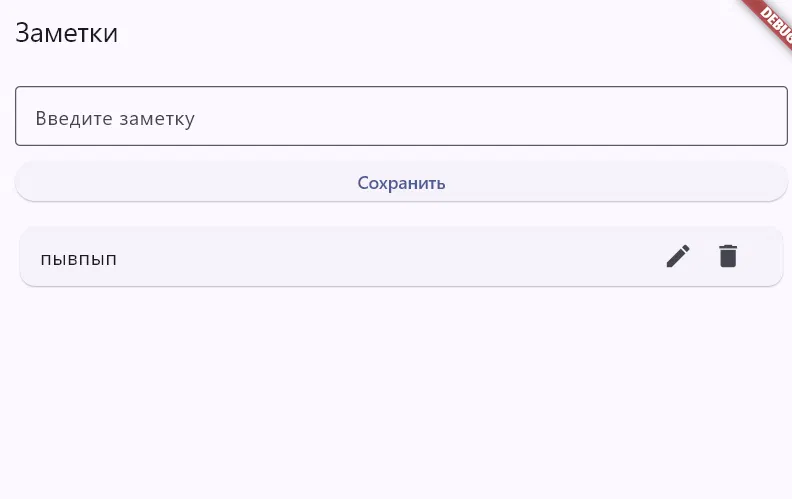
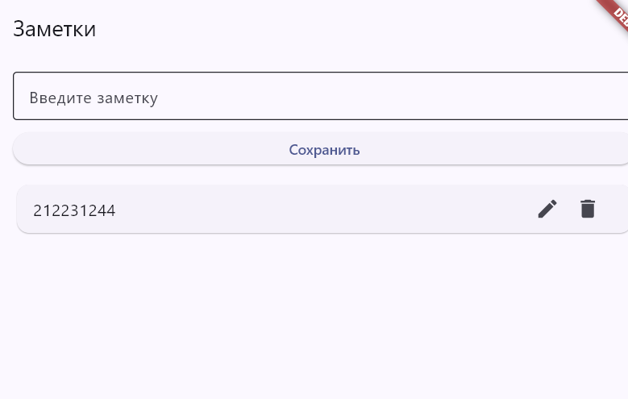
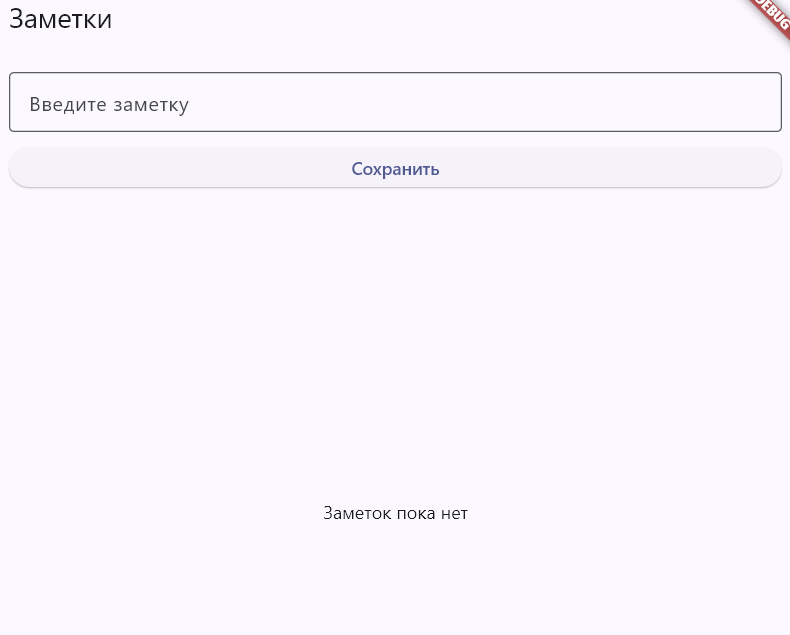

# Цель задания:

Простое приложение для ведения заметок. Пользователь вводит текст в поле, нажимает «Сохранить», и заметка появляется ниже в виде списка. Заметки можно редактировать и удалять.

## Ход работы:

### 1. Запустили приложение

При первом запуске заметок ещё нет. На экране отображаются заголовок «Заметки», поле для ввода с подсказкой «Введите заметку», кнопка «Сохранить» и надпись «Заметок пока нет».

### 2. Добавили заметку

Ввели текст в поле и нажали «Сохранить». Заметка появилась ниже в списке в виде карточки. Справа у неё две иконки: карандаш для редактирования и корзина для удаления. Поле ввода после сохранения очистилось.

### 3. Изменили заметку

Нажали на иконку карандаша, текст заметки попал в поле ввода, мы его изменили и сохранили. В списке отобразился обновлённый текст.

### 4. Удалили заметку

Нажали на иконку корзины. Заметка пропала из списка, и снова появилась надпись «Заметок пока нет».

все фотки находятся в папке images.

## Что реализовано:

- Добавление заметки: ввод текста в поле и кнопка «Сохранить».
- Отображение всех заметок списком под полем ввода.
- Редактирование существующей заметки (иконка карандаша).
- Удаление заметки (иконка корзины).