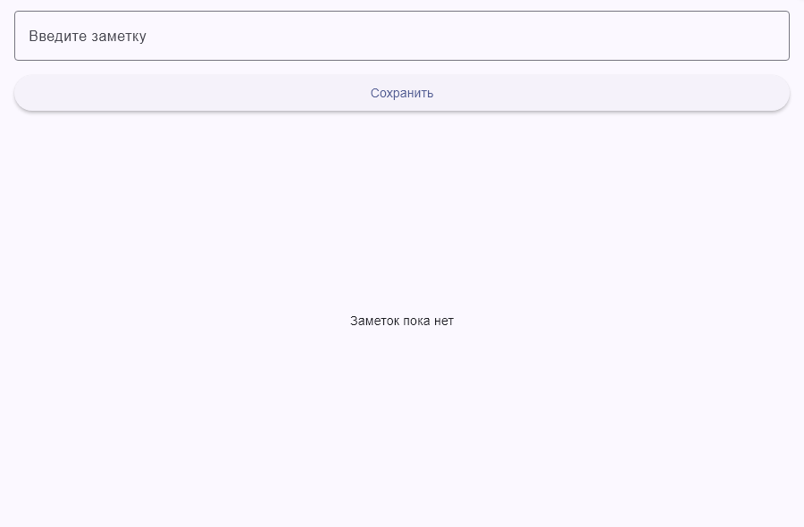
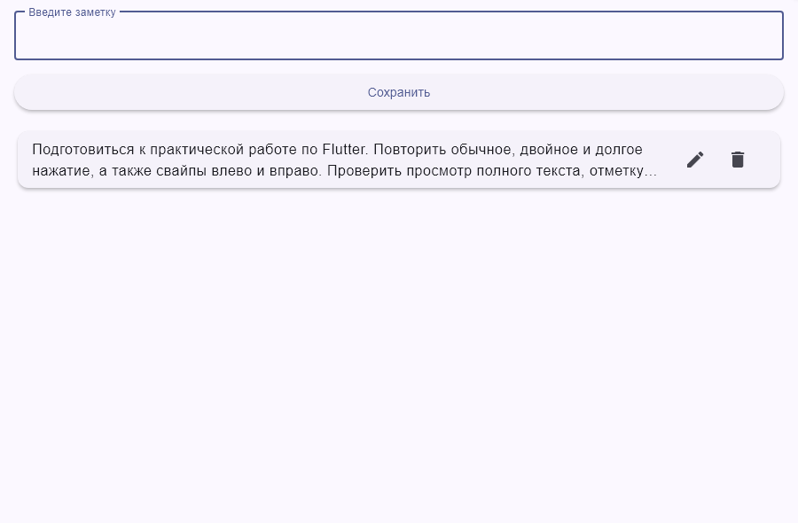
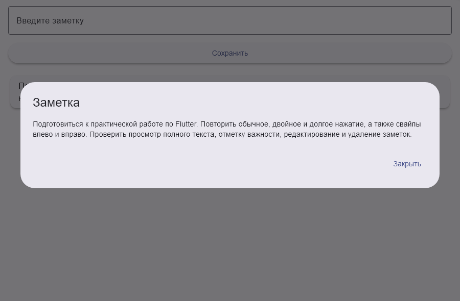
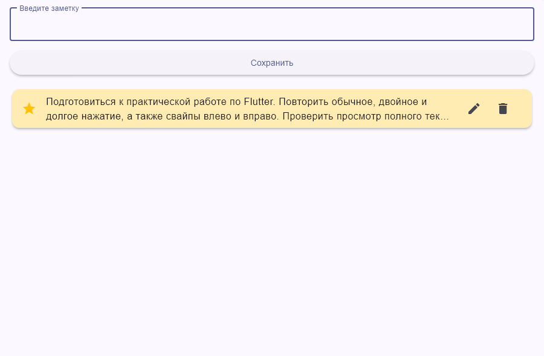
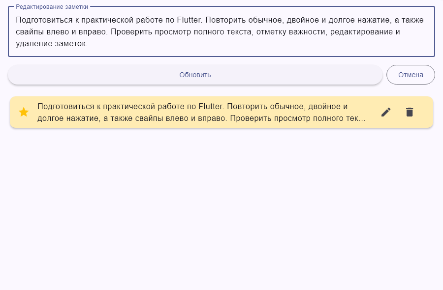
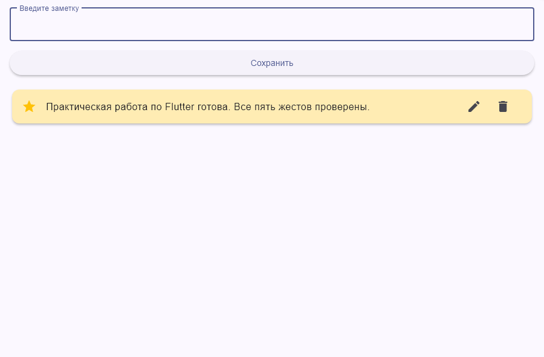
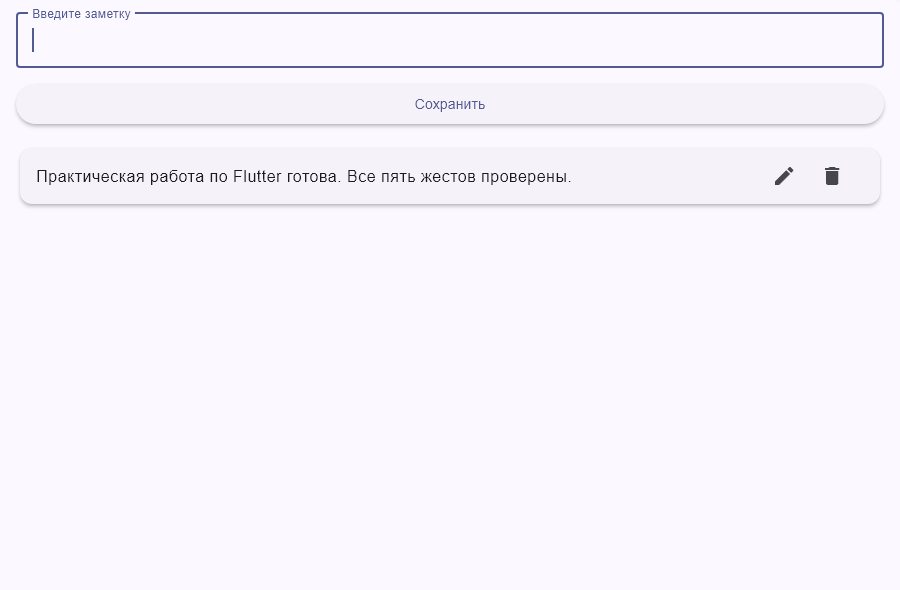
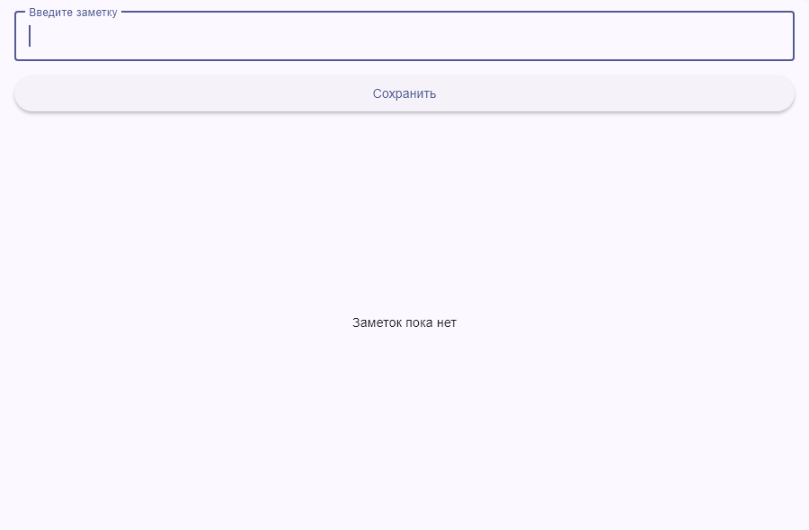

# Цель задания:

Доработать приложение «Заметки» и добавить управление с помощью жестов. Для оценки 4 реализовать просмотр полного текста обычным нажатием и отметку важности двойным нажатием. Для оценки 5 добавить редактирование долгим нажатием, удаление свайпом влево и снятие важности свайпом вправо.

## Ход работы:

### 1. Запустили приложение

При первом запуске заметок ещё нет. На экране отображаются заголовок «Заметки», поле «Введите заметку», кнопка «Сохранить» и надпись «Заметок пока нет».

### 2. Добавили заметку

Ввели текст в поле и нажали «Сохранить». Заметка появилась в списке в виде карточки. В карточке отображаются не больше двух строк текста, длинный текст сокращается многоточием. Поле ввода после сохранения очистилось.

### 3. Открыли полный текст обычным нажатием

Нажали один раз на карточку заметки. Сработал обработчик `onTap`, который открыл окно с полным текстом. Если текст не помещается, его можно прокрутить. Для возврата к списку нажали «Закрыть».

### 4. Отметили заметку как важную двойным нажатием

Нажали два раза на карточку заметки. Сработал обработчик `onDoubleTap`. Карточка получила жёлтый фон, слева появилась звезда. Повторное двойное нажатие оставляет заметку важной.

### 5. Открыли редактирование долгим нажатием

Нажали на карточку и удерживали нажатие. Сработал обработчик `onLongPress`. Текст выбранной заметки появился в поле ввода, подпись поля сменилась на «Редактирование заметки», а кнопка — на «Обновить». Рядом появилась кнопка «Отмена».

### 6. Сохранили изменения

Изменили текст в поле и нажали «Обновить». Текст существующей заметки обновился, новая карточка не добавилась. Поле ввода очистилось, режим редактирования завершился. Отметка важности сохранилась.

### 7. Сняли важность свайпом вправо

Провели по карточке слева направо. С помощью `Dismissible` обработали направление `DismissDirection.startToEnd` и сняли отметку важности. Звезда исчезла, цвет карточки стал обычным. Сама заметка осталась в списке, потому что `confirmDismiss` для этого направления возвращает `false`.

### 8. Удалили заметку свайпом влево

Провели по карточке справа налево. Карточка исчезла, а обработчик `onDismissed` вызвал удаление заметки из списка. Так как это была единственная заметка, снова появилась надпись «Заметок пока нет».

Все фотографии находятся в папке images.

## Что реализовано:

- Обычное нажатие (`onTap`) — просмотр полного текста заметки.
- Двойное нажатие (`onDoubleTap`) — отметка заметки как важной, жёлтый фон и звезда.
- Долгое нажатие (`onLongPress`) — редактирование выбранной заметки с сохранением изменений.
- Свайп влево — удаление заметки из списка.
- Свайп вправо — восстановление обычного статуса заметки без удаления.
- Добавление заметок, отмена редактирования и прежние кнопки редактирования и удаления сохранены.
- В модель `Note` добавлены идентификатор, текст и признак важности. Список заметок и индекс редактируемой заметки хранятся в `NotesState`, действия выполняются через `NotesCubit`.
- Комментарии в коде отсутствуют.

## Результат:

Выполнены условия на оценки 4 и 5. Анализатор Flutter не обнаружил ошибок. Автоматические тесты проверили все пять жестов, обновление текста, сохранение важности при редактировании и корректное удаление заметок.
